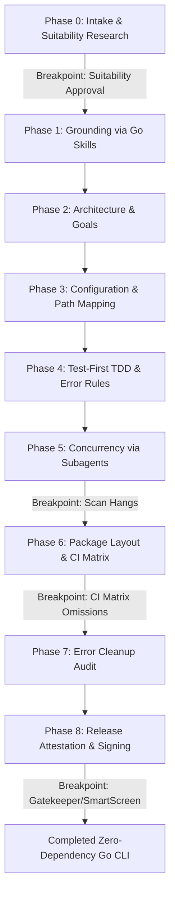

# CLI to Go Migration Skill

This skill guides the end-to-end (E2E) migration of a command-line interface (CLI) tool from any source language (e.g., TypeScript/Node, Python, Ruby) to Go. Use it to minimize runtime dependencies, maximize native performance, ensure filesystem security, and write robust, multi-platform binaries.

---

## Migration Pipeline Overview

The migration follows nine sequential phases. Each phase requires specific human-AI coordination. Explicit breakpoints are defined where the AI agent must stop and prompt the user for validation.



---

## Phase 0: Intake and Suitability Research

Before initiating any migration, research the target codebase to verify if the proposed language is a suitable replacement.
1. **Identify User Goals**: Ask the user to specify the location of the codebase to migrate, define their target performance/security/maintenance metrics, and describe core use cases.
2. **Review Stack Alternatives**: Proactively audit alternative target stacks based on development complexity, language rules friction, runtime distribution overhead, and ecosystem support. Use a generalized prompt pattern:
   - Identify alternative stacks:
     ```text
     Research online and identify 3-5 stack alternatives to use over [current stack] and explain why (e.g., performance, security) with specific examples and links
     ```
3. **Lock in Target Stack**: Check for prior work and research target-specific idioms:
   - Prior work check:
     ```text
     I want to port [tool/repository] to [target language]. Did anyone do this before?
     ```
   - Target idioms and patterns check:
     ```text
     Identify 3-5 patterns on how to / how NOT use [target language] and explain them to me
     ```
4. **Analyze the source stack**:
   * Inspect the codebase dependencies (e.g., scan package manifests like `package.json` or `requirements.txt`) to assess dependency overhead and vulnerability vectors.
   * Evaluate startup latency requirements. If the tool is invoked frequently in scripts (like shell tools) where startup latency must be sub-10ms, compiled binaries are highly suitable.
5. **Present Suitability Report**: Stop and present a brief suitability evaluation comparing package size, startup speed, readability-by-strangers, and complexity tradeoffs. Do not proceed without user approval.

---

## Phase 1: Environment Grounding (Golang Skills Setup)

Prepare the workspace environment and verify that all necessary grounding files are in place.
1. **Initialize Git history**: Before writing any code, check if the target directory is a Git repository. If not, initialize it (`git init`) to establish a clean change history. The agent must do this itself rather than instructing the user to run the command, but must request user confirmation before initializing the repository.
2. **Scan for installed skills**: Crawl the project workspace (`.agents/skills/`) and global directories for the standard Go skills cluster. Proactively check for community options and install them:
   - Search prompt:
     ```text
     what are the top community agent skills for `go`?
     ```
   - Install prompt:
     ```text
     add all skills samber/cc-skills-golang
     ```
3. **Automated skill installation & blocking**: If any of these skills are missing, the agent must explicitly block execution. However, instead of asking or instructing the user to install them, the agent must install them directly (either by running `skl add` or copying the skill directories to the workspace). The agent must ask the user for confirmation before executing the install/copy command or making any other persistent changes to the workspace. Do not proceed to subsequent phases until these grounding skills are active in the workspace.
4. **Honesty and no hallucinated shortcuts**: The agent must maintain absolute honesty about limitations. Never write placeholder or fake installation scripts that hang or do not terminate. If a dependency cannot be downloaded via git, fail gracefully and ask the user for advice or utilize fallback HTTP checks, explicitly documenting the limitation.

---

## Phase 2: Architecture, Stack Analysis, and Security Constraints

Define the core boundaries of the new Go CLI.
1. **Define target metrics**: Set limits for final compiled binary size (e.g., under 10MB), startup latency (e.g., under 5ms), memory footprint, and ensure `readability-by-strangers` is prioritized as a core code quality metric for team collaboration.
2. **Planning prompts**: Initialize planning and onboarding targets by requesting:
   ```text
   Plan 100% functionality port of `npx skills` to Go, focusing on safety, best practices, and with 90% unit test coverage. Pull the repo and map things out. Ask me any questions
   ```
   And:
   ```text
   For the MVP, we target Antigravity 2 support as default and fallback to universal through the standards-compliant '.agents' directory (if multiple agents detected)
   ```
3. **Enforce zero-dependency core**: Use the Go standard library for all core CLI tasks (file I/O, networking, terminal formatting). Limit external packages strictly to configuration parsing (such as `gopkg.in/yaml.v3` or `github.com/pelletier/go-toml`).
4. **Establish filesystem constraints**: Enforce zero-trust checks on all folder operations:
   * Sanitize all input filenames (e.g. replacing special characters with hyphens, truncating to 255 characters).
   * Block directory traversal attempts (CWE-22) by verifying paths remain within the designated workspace.

---

## Phase 3: Registry Mapping and Host Path Resolution

Map how the existing CLI discovers and targets application environments.
1. **Define core configurations**: Declare agent structures (e.g., `AgentConfig`, `AgentType`) in `types.go`.
2. **Resolve dynamic path differences**: Map platform-specific directories dynamically at runtime using:
   * `os.UserHomeDir()` to target user home folders on Unix/macOS.
   * `os.Getenv("APPDATA")` or `os.Getenv("USERPROFILE")` to target Windows folders.
   * `os.Getenv("XDG_CONFIG_HOME")` (falling back to `~/.config`) for Linux standard paths.
3. **UX rules & fallbacks**: Build fallback defaults in code when multiple environment targets are active, and structure dynamic onboarding prompts to guide users who lack installed dependencies.

---

## Phase 4: Test-First Development and Error Commandments

Establish a test-driven development (TDD) harness using Go's standard test tools.
1. **Initiate TDD & commandments**: Direct the agent to follow best practices:
   ```text
   Apply principles from https://preslav.me/2026/05/19/10-golang-error-handling-commandments/
   ```
2. **Scaffold failing tests first**: For each CLI subcommand, write a `*_test.go` file using table-driven test patterns before implementing any logic. Ensure `go test ./...` fails gracefully due to missing dependencies.
3. **Integrate error commandments**: Align error structures with Preslav Rachev's commandments:
   * Treat errors as values: Always check returns immediately using `if err != nil`.
   * Wrap errors at package boundaries: Add context using `fmt.Errorf("action: %w", err)` to preserve trace logs.
   * Do not use exceptions or panic/recover blocks for normal CLI control flows.

---

## Phase 5: Multi-Subagent Concurrency (Elephant & Goldfish Model)

To migrate a large subcommand surface area efficiently, parallelize development using isolated subagents.
1. **Elephant (Main Agent)**: Acting as the coordinator, design the subcommand routing map in `main.go` and define option structs.
2. **Goldfish (Subagents)**: Spawn transient, isolated subagents inside separate workspace branches to concurrently build and test individual commands (`init`, `add`, `list`, etc.).
3. **Subagent Execution Loop**: Have each subagent map command option flags, write table-driven test cases (such as mocking remote HTTP servers), run tests in isolation, and report clean code. Audit command parity using:
   ```text
   did you cover 100% of the original CLI? 
   have subagents research each option individually and each test and fill in the gaps
   ```

> [!WARNING]
> ### User Intervention Breakpoint 1: Recursive Traversal CPU Hangs
> **Trigger**: When translating directory scanner or copying commands, the model may execute unconstrained recursive lookups that enter deep hidden folders (such as `.git/` or `node_modules/`), pegging the CPU at 100%.
> **Action**: Stop work and ask the user to verify traversal exclusions. Implement these limits in the traversal loop:
> * Restrict recursive scanning to a maximum folder depth of 2.
> * Explicitly ignore `.git/`, `node_modules/`, and standard build output paths.

---

## Phase 6: Package Layout and CI Multi-Platform Matrix

Structure the repository for direct distribution and configure the continuous integration pipeline.
1. **Go package layout**: Place `main.go` directly at the root of the module (rather than inside a nested subfolder like `cmd/tool/`) to keep the layout flat and support direct native installation:
   ```bash
   go install github.com/username/repo@latest
   ```
   Isolate all core domain packages inside a subdirectory (e.g. `src/skl/`).
2. **Configure CI workflow**: Setup GitHub Actions workflow `.github/workflows/ci.yml`.

> [!IMPORTANT]
> ### User Intervention Breakpoint 2: CI Matrix Omissions
> **Trigger**: AI models frequently generate a standard `ci.yml` that only compiles for the host Linux runner (`ubuntu-latest`), neglecting multi-platform compilation verification.
> **Action**: Pause and request user approval to update `ci.yml` with a multi-platform runner matrix:
> ```yaml
> strategy:
>   matrix:
>     os: [ubuntu-latest, macos-latest, windows-latest]
> ```
> Verify that tests run successfully and native binaries compile natively on all target runners.

---

## Phase 7: Concise Error Messaging Audit

Refactor error messages to focus on concise, action-oriented descriptions of failures.
1. **Error formatting prompt**: Instruct the agent to clean up messaging and conventions:
   ```text
   replace [verbose]  with a simple emoji and use concise logs. see https://preslav.me/2026/05/19/10-golang-error-handling-commandments/ for best practices
   ```
2. **Scan error strings**: Audit all Go files to identify verbose, exception-like error strings (such as `failed to get current working directory: %w` or `failed to extract downloaded zip: %w`).
3. **Shorten and focus error messages**: Rather than focusing on casing conventions, shorten error strings by stripping verbose "failed to" prefixes and directly identifying the failing action:
   * `failed to download remote repository: %w` -> `download remote: %w`
   * `failed to get current working directory: %w` -> `get working directory: %w`
   * `failed to extract downloaded zip: %w` -> `extract zip: %w`

---

## Phase 8: Host-Level Trust Boundaries and Release Signing

Manage the target operating system security filters for compiled releases.

> [!CAUTION]
> ### User Intervention Breakpoint 3: macOS Gatekeeper & Windows SmartScreen Quarantine Blocks
> **Trigger**: While Go successfully cross-compiles binaries, standard CI builders cannot sign releases. When distributed, macOS Gatekeeper quarantines unsigned binaries (`com.apple.quarantine`), and Windows SmartScreen flags them.
> **Action**: Stop and coordinate with the user to establish trust pipelines:
> 1. **macOS Signing**: Compile production macOS releases locally on the developer's workstation where Keychain credentials reside. Run `codesign` natively to sign the binary before pushing it to release assets.
> 2. **Windows Attribution**: Cross-compile the Windows target and document the manual unblocking instructions (`Unblock-File -Path .\skl-windows-amd64.exe` or clicking "Run anyway" under SmartScreen) in the project [README.md](https://github.com/alexastrum/skl/blob/main/README.md#running-unsigned-release-binaries).

---

## Phase 9: Documentation Grounding and Agent Metadata (README and AGENTS.md)

Establish clear documentation boundaries to guide users and other agents working within the repository.
1. **Documentation prompt**: Direct the separation of target auditories:
   ```text
   summarize findings for humans in README.md, considerations for agents in AGENTS.md
   ```
2. **Developer configurations (AGENTS.md)**: Document agent discovery and dynamic scoping. Map the home directories and configuration folders of the 51+ supported agents.
   * Include a Mermaid diagram visual map detailing symlink routing paths from canonical global/local scopes to agent-specific directories.
   * Detail compilation architectures and systems configurations, documenting macOS Keychain codesigning workarounds and Windows SmartScreen unblocking commands.
   * Enforce documentation grounding & humanizer limits: Only apply the `/humanizer` skill to human-facing files (like `README.md` or CLI usage `--help` documentation). Do NOT run the `/humanizer` skill on `AGENTS.md`, since it is designed to be parsed as strict agentic context grounding metadata by AI models.
3. **User-facing guides (README.md)**: Describe installation options, unblocking steps, and the architectural rationale for compiling to Go.
   * Outline a clear footprint comparison table detailing physical package size, line counts, and startup times between the TypeScript and Go implementations.
   * Document clear unblocking commands to bypass unsigned OS quarantines on macOS (`xattr -d com.apple.quarantine`) and Windows (`Unblock-File`).
