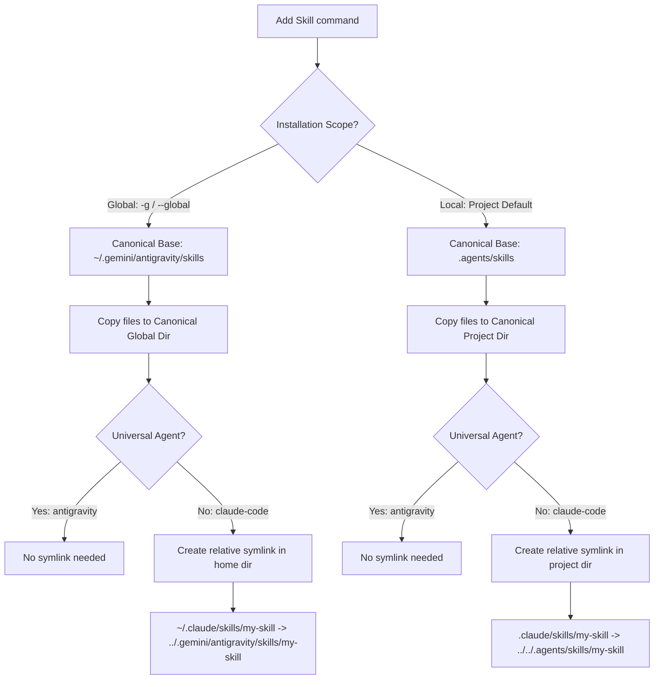

# 🤖 Agent Configurations & Discovery in skl

`skl` provides first-class support for **40+ Agent environments**, including major IDE plugins, standalone clients, CLI agents, and development assistants. 

Each agent defines its own configuration directories, skills folder mappings, and active detection algorithms. At runtime, `skl` dynamically evaluates your local filesystem and active environment variables to determine which agents are installed, allowing it to route, copy, and link your skills seamlessly.


## 📂 Mapped Agents & Environments

The following table summarizes a selection of key agents supported by `skl`:

| Agent Type Key | Display Name | Project Skills Folder | Global Skills Folder | Detection Strategy |
| :--- | :--- | :--- | :--- | :--- |
| **`antigravity`** | Antigravity | `.agents/skills` | `~/.gemini/antigravity/skills` | Detects directory `~/.gemini/antigravity` |
| **`universal`** | Universal | `.agents/skills` | `~/.config/agents/skills` | Fallback project-level routing (always active) |
| **`claude-code`** | Claude Code | `.claude/skills` | `~/.claude/skills` | Detects directory `~/.claude` or `CLAUDE_CONFIG_DIR` |
| **`cursor`** | Cursor | `.agents/skills` | `~/.cursor/skills` | Detects directory `~/.cursor` |
| **`cline`** | Cline | `.agents/skills` | `~/.agents/skills` | Detects directory `~/.cline` |
| **`aider-desk`** | AiderDesk | `.aider-desk/skills` | `~/.aider-desk/skills` | Detects directory `~/.aider-desk` |
| **`zed`** | Zed | `.agents/skills` | `~/.agents/skills` | Detects directory `zed` in config/AppData/Flatpak |
| **`copilot`** | Copilot | `.agents/skills` | `~/.copilot/skills` | Detects directory `~/.copilot` |
| **`windsurf`** | Windsurf | `.windsurf/skills` | `~/.codeium/windsurf/skills` | Detects directory `~/.codeium/windsurf` |


## ⚡ Active Discovery & Detection Mechanics

In `skl`, discovery is handled via the `DetectInstalled` callback inside `AgentConfig`. 
At runtime, when no specific agent is targeted, `skl` executes the following algorithm:

```go
func detectInstalledAgents(home, configHome, cwd string) []AgentType {
	var installed []AgentType
	for agentType, config := range Agents {
		if config.DetectInstalled != nil && config.DetectInstalled(home, configHome, cwd) {
			installed = append(installed, agentType)
		}
	}
	return installed
}
```

### 1. Active Project-Level Detection
Checks if the current project workspace directory (`cwd`) contains active agent folders (e.g. `.cursor/`, `.cline/`, `.zed/`, `.aider.conf.yml`, etc.). If so, that agent is immediately considered active for the project, and any newly added skills are linked into their respective local directories.

### 2. Environment Variables & Global Detection
Leverages system environment variables to locate configuration files correctly on macOS, Linux, and Windows:
- `XDG_CONFIG_HOME` (falls back to `~/.config` on UNIX)
- `APPDATA` & `LOCALAPPDATA` (for Windows registry paths)
- `CODEX_HOME`, `CLAUDE_CONFIG_DIR`, `VIBE_HOME` for specialized developer setups.


## 🔗 How Symlink Mappings are Routed

When you add a skill, `skl` automatically resolves the correct link targets depending on the installation scope:



This elegant design guarantees that files are never duplicated, updates apply universally to all agents, and resources are kept light and secure!
