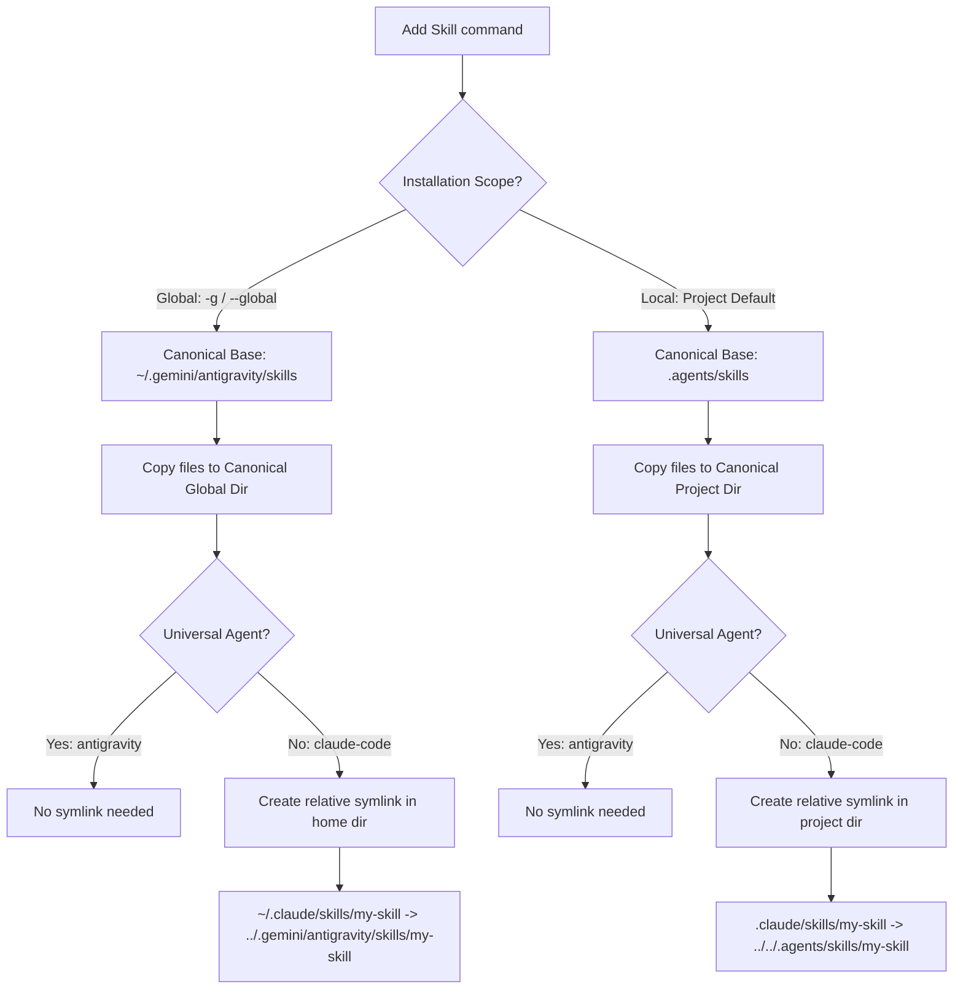

# 🤖 Agent Configurations & Discovery

`skl` supports 40+ agent environments. It evaluates the local filesystem and environment variables to detect installed agents, routing and linking skills dynamically.

We enforce strict feature parity (commands, flags, platforms) with the original TypeScript `skills` npm package. Antigravity maps to `~/.gemini/config` (original IDE) and `~/.gemini/antigravity` (2.0).

IMPORTANT: ONLY WHEN EDITING README.md or human docs (eg --help) run /humanizer skill.

## ⚡ Discovery Mechanics

`skl` detects agents via project folders (e.g., `.cursor`, `.cline`, `.zed`) or environment variables (`XDG_CONFIG_HOME`, `APPDATA`, etc.):

```go
func detectInstalledAgents(home, configHome, cwd string) []AgentType {
	var installed []AgentType
	for agentType, config := range Agents {
		if config.DetectInstalled != nil && config.DetectInstalled(home, configHome, cwd) {
			installed = append(installed, agentType)
		}
	}
	return installed
}
```

## 🔗 Symlink Routing

Skills are mapped using relative symlinks to prevent duplication:



## 🛠️ Multi-Platform Compilation & Path Mappings

To ensure that `skl` can be deployed across Linux, Windows, and macOS architectures, the CLI tool resolves home directories and environments dynamically at runtime:
*   **Linux**: Crawls `$XDG_CONFIG_HOME` or falls back to standard UNIX directories (e.g., `~/.config/`).
*   **Windows**: Dynamic resolution maps to `%APPDATA%` or `%USERPROFILE%` targets depending on user credentials.
*   **macOS**: Resolves configuration folders directly using standard `~/.gemini/config` and `~/.gemini/antigravity` structures.

### Multi-Platform CI Builds
Our GitHub Actions pipeline (`ci.yml`) is configured to compile and run tests natively on all three major platforms using a build matrix:
```yaml
strategy:
  matrix:
    os: [ubuntu-latest, macos-latest, windows-latest]
```
This guarantees that the codebase builds and passes all tests across Linux, macOS, and Windows.

### The Local Compile Hack (macOS Gatekeeper & Code Signing)
While Go can easily cross-compile to macOS from a Linux runner, the resulting binary is unsigned. When distributed, macOS Gatekeeper stamps it with `com.apple.quarantine` and blocks execution, throwing a security warning. To bypass this restriction:
1. **Local Compilation**: We compile the official production macOS releases locally on the developer's macOS machine (`go build -o skl-darwin-arm64` and `go build -o skl-darwin-amd64`).
2. **Local Signing**: Since the developer's local environment has access to the developer keychain and native signing tools (`codesign`), the binary is signed natively on macOS.
3. **Distribution**: The signed binaries are then uploaded directly to release assets, bypassing standard runner constraints.

### Windows Compilation and SmartScreen
For Windows platforms, compiling natively in CI or cross-compiling on macOS/Linux using `GOOS=windows GOARCH=amd64 go build` produces a functional `skl-windows-amd64.exe` binary. However, because this binary is unsigned, Windows SmartScreen will flag the executable.
* **Distribution Guidelines**: Standard users running the pre-compiled binary must unblock the file. Refer to [README.md](https://github.com/alexastrum/skl/blob/main/README.md#running-unsigned-release-binaries) for step-by-step instructions on running unsigned Windows and macOS executables.


