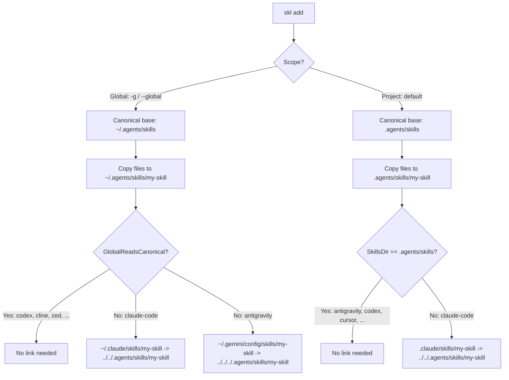

# 🤖 Agent Configurations & Discovery

`skl` supports 79 agent environments (see `AllAgentTypes` in `src/skl/types.go`). It evaluates the local filesystem and environment variables to detect installed agents, routing and linking skills dynamically.

We track the original TypeScript `skills` npm package (vercel-labs/skills v1.7.6) command for command, flag for flag, and platform for platform. `skl --version` prints the upstream version it tracks. The intentional divergences are listed at the end of this file; everything else should match upstream byte for byte where output is compared (lockfiles, diagnostics, `--json`).

### Antigravity mapping

* Project installs go to `.agents/skills/` like every other universal agent.
* Global installs go to `~/.gemini/config/skills/` (`GlobalReadsCanonical: false`, upstream #2566). Antigravity does not read `~/.agents/skills`, so the global canonical copy is linked into `~/.gemini/config/skills/<skill>`.
* Detection accepts either `~/.gemini/config` (original IDE) or `~/.gemini/antigravity` (2.0). Upstream checks only `~/.gemini/antigravity`.
* `antigravity-cli` is a separate agent with the same folders. It is detected via `~/.gemini/antigravity-cli` on disk, or `ANTIGRAVITY_CLI_ALIAS` in the environment when `skl` runs inside the CLI.

IMPORTANT: ONLY WHEN EDITING README.md or human docs (eg --help) run /humanizer skill.

## ⚡ Discovery Mechanics

`skl` detects agents via project folders (e.g., `.cursor`, `.claude`, `.zed`) or home and config directories (`$HOME`, `XDG_CONFIG_HOME`, `APPDATA`, agent-specific `*_HOME` variables). Each `AgentConfig` in `src/skl/types.go` carries its own `DetectInstalled` predicate; `DetectInstalledAgents` walks them in upstream order and skips the `universal` pseudo-agent:

```go
func DetectInstalledAgents(cwd string) []AgentType {
	env := DefaultAgentEnv()
	var results []AgentType
	for _, k := range orderedAgentTypes(Agents) {
		if k == AgentUniversal {
			continue
		}
		v := Agents[k]
		if v.DetectInstalled != nil && v.DetectInstalled(env.Home, env.ConfigHome, cwd) {
			results = append(results, k)
		}
	}
	return results
}
```

`DetectAgent` in `src/skl/detect_agent.go` is a different question: which agent is running `skl` right now (a port of `@vercel/detect-agent`). It reads environment variables such as `CLAUDECODE`, `CODEX_THREAD_ID`, `CURSOR_AGENT`, `GEMINI_CLI`, `ANTIGRAVITY_AGENT`, and `ANTIGRAVITY_CLI_ALIAS`. When it finds one, `add` runs non-interactively and targets that agent.

## 🔗 Symlink Routing

The canonical skill directory is `.agents/skills` in a project and `~/.agents/skills` globally (`GetCanonicalSkillsDir` in `src/skl/config.go`; `skl config set canonicalDir.{project,global}` overrides either). Skills are copied there once and linked into each agent folder with relative symlinks (directory junctions on Windows when symlinks are unavailable). Agents whose folder already is the canonical directory get no link.



`--copy` replaces every link with an independent copy and records `installMode: "copy"` in the lockfile, so `update` and `install` keep copying. When all targets share one directory (or all are Eve subagents) the default mode is already copy, matching upstream `DefaultInstallMode`.

## 🛠️ Multi-Platform Compilation & Path Mappings

To ensure that `skl` can be deployed across Linux, Windows, and macOS architectures, the CLI tool resolves home directories and environments dynamically at runtime:
*   **Linux**: Crawls `$XDG_CONFIG_HOME` or falls back to standard UNIX directories (e.g., `~/.config/`).
*   **Windows**: Dynamic resolution maps to `%APPDATA%` or `%USERPROFILE%` targets depending on user credentials. Symlinks fall back to directory junctions.
*   **macOS**: Resolves configuration folders directly using standard `~/.gemini/config` and `~/.gemini/antigravity` structures.

### Multi-Platform CI Builds
Our GitHub Actions pipeline (`ci.yml`) is configured to compile and run tests natively on all three major platforms using a build matrix:
```yaml
strategy:
  matrix:
    os: [ubuntu-latest, macos-latest, windows-latest]
```
This guarantees that the codebase builds and passes all tests across Linux, macOS, and Windows. Tests are hermetic: they swap `HOME`, `USERPROFILE`, `XDG_CONFIG_HOME`, and `XDG_STATE_HOME` to temp dirs, clear agent and CI variables, call `RefreshAgents()`, and never touch the network (`httptest` servers, local `git init` repos, and fake `git`/`ntn` scripts instead).

### The Local Compile Hack (macOS Gatekeeper & Code Signing)
While Go can easily cross-compile to macOS from a Linux runner, the resulting binary is unsigned. When distributed, macOS Gatekeeper stamps it with `com.apple.quarantine` and blocks execution, throwing a security warning. To bypass this restriction:
1. **Local Compilation**: We compile the official production macOS releases locally on the developer's macOS machine (`go build -o skl-darwin-arm64` and `go build -o skl-darwin-amd64`).
2. **Local Signing**: Since the developer's local environment has access to the developer keychain and native signing tools (`codesign`), the binary is signed natively on macOS.
3. **Distribution**: The signed binaries are then uploaded directly to release assets, bypassing standard runner constraints.

### Windows Compilation and SmartScreen
For Windows platforms, compiling natively in CI or cross-compiling on macOS/Linux using `GOOS=windows GOARCH=amd64 go build` produces a functional `skl-windows-amd64.exe` binary. However, because this binary is unsigned, Windows SmartScreen will flag the executable.
* **Distribution Guidelines**: Standard users running the pre-compiled binary must unblock the file. Refer to [README.md](https://github.com/alexastrum/skl/blob/main/README.md#running-unsigned-release-binaries) for step-by-step instructions on running unsigned Windows and macOS executables.

## 🔀 Intentional divergences from upstream

Each of these is marked with an `// Intentional divergence:` comment at the point in the code where it happens. Do not "fix" them back to upstream behavior without updating this list.

| Area | Upstream (v1.7.6) | `skl` | Where |
| :--- | :--- | :--- | :--- |
| Antigravity CLI detection | `@vercel/detect-agent@1.2.3` has no `ANTIGRAVITY_CLI_ALIAS` check; the CLI is reported as `antigravity`. | `ANTIGRAVITY_CLI_ALIAS` set in the environment reports `antigravity-cli`. | `detect_agent.go` |
| Antigravity install detection | Only `~/.gemini/antigravity` marks Antigravity as installed. | `~/.gemini/config` or `~/.gemini/antigravity` does. | `types.go` (`antigravity.DetectInstalled`) |
| Terminal escape stripping | `CONTROL_RE` leaves a lone `ESC` (0x1b) in place. | `StripTerminalEscapes` also removes a lone `ESC`, since it can still start a sequence in the terminal that prints it. | `types.go` |
| Tar archives | `download-source` silently skips symlink and hardlink entries. | `ExtractTarArchive` rejects the archive with a diagnostic. | `providers.go` |
| `git` missing | The clone fails. | For public GitHub HTTPS sources, `-y` / `--yes` downloads the repository ZIP archive instead (`cloneOrDownloadRepo`). Without `-y` the error says how. | `providers.go` |
| Telemetry | Sends anonymous usage telemetry (opt-out). | None. No network call except the one the command needs. | n/a |
| Security audit | Runs a security audit after install and records the result in the lock. | Not ported. `security` is always `null` in `--json` output. | `add.go` |
| Post-install prompt | `add` offers to run `find` for related skills. | Not ported (it would trigger a network call). | `add.go` |
| `config` command | Not present. | `skl config set|get canonicalDir.global|canonicalDir.project` writes `$XDG_CONFIG_HOME/skills/config.json`. | `config.go`, `main.go` |
| Interactive pickers | Raw TTY, arrow-key menus. | Line-based prompts (type a number or name). Without a TTY a required prompt fails with `SKILLS_PROMPT_REQUIRES_TTY`. | `add.go`, `find.go`, `remove.go`, `experimental_sync.go` |
| Global GitHub update check | Uses the Git Trees API fast path. | Clones the repository. | `update.go` |
| No agent detected | `add` offers all agents with `-y`, or prompts. | Same, except the legacy `AddSkill` entry point installs for Antigravity plus the canonical dir and prints the agy-cli tip (`maybeSuggestAgy`). `--agent universal` always means the canonical directory. | `add.go`, `installer.go`, `agy-onboarding.go` |

Known approximations rather than divergences: non-ASCII collation in `jsLocaleCompare` (used for lock hashes) is approximate, and JSON lone surrogates decode to U+FFFD.
