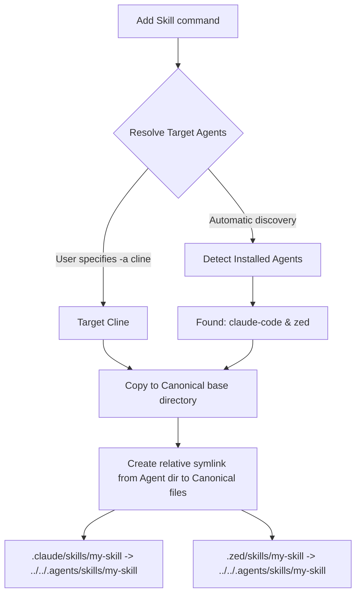

# Agent configurations and discovery in skl

`skl` supports over 40 agent environments, including major IDE plugins, standalone clients, CLI tools, and development assistants. 

Each agent defines its own configuration directories, skills folder mappings, and active detection rules. At runtime, `skl` dynamically evaluates your local filesystem and active environment variables to determine which agents are installed, allowing it to route, copy, and link your skills.

## Mapped agents and environments

The following table summarizes a selection of key agents supported by `skl`:

| Agent Type Key | Display Name | Project Skills Folder | Global Skills Folder | Detection Strategy |
| :--- | :--- | :--- | :--- | :--- |
| **`antigravity`** | Antigravity | `.agents/skills` | `~/.gemini/antigravity/skills` | Primary universal agent (always included) |
| **`universal`** | Universal | `.agents/skills` | *Not supported* | Fallback project-level routing (always active) |
| **`claude-code`** | Claude Code | `.claude/skills` | `~/.claude/skills` | Detects directory `~/.claude` or `CLAUDE_CONFIG_DIR` |
| **`cursor`** | Cursor | `.cursor/skills` | `~/.config/Cursor/User/skills` | Detects `.config/Cursor` or system application config directories |
| **`cline`** | Cline | `.cline/skills` | `~/.config/Code/User/globalStorage/saoudrizwan.claude-dev/skills` | Detects Code global storage folders |
| **`aider-desk`** | AiderDesk | `.aider-desk/skills` | `~/.aider-desk/skills` | Detects `~/.aider-desk` folder |
| **`zed`** | Zed | `.zed/skills` | `~/.config/zed/skills` | Detects `.config/zed` or Flatpak environment folders |
| **`copilot`** | Copilot | `.copilot/skills` | `~/.config/github-copilot/skills` | Detects `.config/github-copilot` folder |
| **`windsurf`** | Windsurf | `.windsurf/skills` | `~/.config/Windsurf/User/skills` | Detects `.config/Windsurf` folder |

## Active discovery and detection mechanics

In `skl`, discovery is handled via the `DetectInstalled` callback inside `AgentConfig`. 
At runtime, when no specific agent is targeted, `skl` executes the following algorithm:

```go
func detectInstalledAgents(home, configHome, cwd string) []AgentType {
	var installed []AgentType
	for agentType, config := range Agents {
		if config.DetectInstalled != nil && config.DetectInstalled(home, configHome, cwd) {
			installed = append(installed, agentType)
		}
	}
	return installed
}
```

### 1. Active project-level detection
Checks if the current project workspace directory (`cwd`) contains active agent folders (e.g. `.cursor/`, `.cline/`, `.zed/`, `.aider.conf.yml`, etc.). If so, that agent is immediately considered active for the project, and any newly added skills are linked into their respective local directories.

### 2. Environment variables and global detection
Leverages system environment variables to locate configuration files correctly on macOS, Linux, and Windows:
- `XDG_CONFIG_HOME` (falls back to `~/.config` on UNIX)
- `APPDATA` & `LOCALAPPDATA` (for Windows registry paths)
- `CODEX_HOME`, `CLAUDE_CONFIG_DIR`, `VIBE_HOME` for specialized developer setups.

## How symlink mappings are routed

When you add a skill, `skl` automatically resolves the correct link targets:



This design guarantees that files are never duplicated, updates apply universally to all agents, and resources are kept light and secure.
