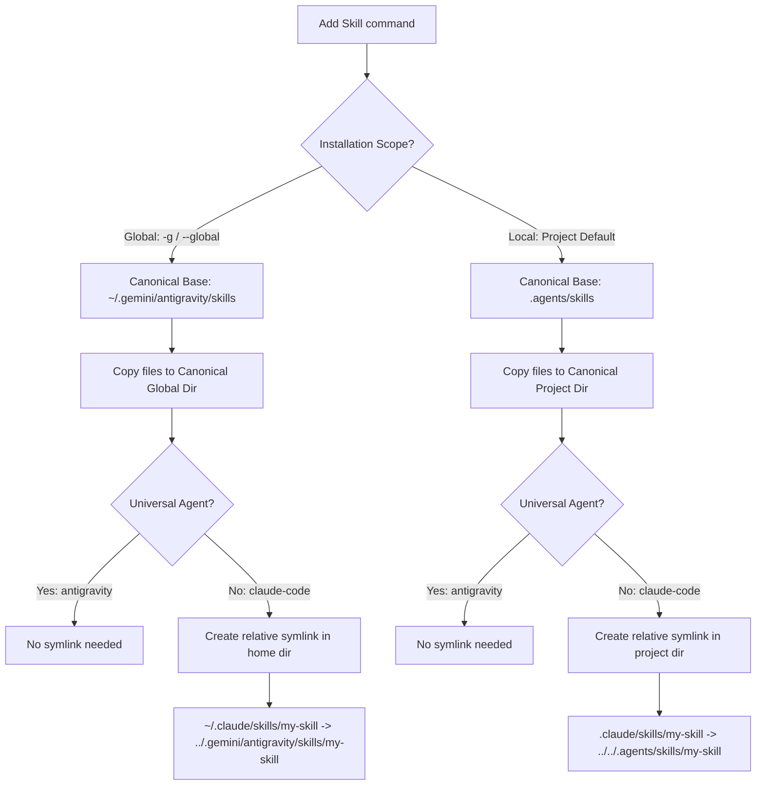

# 🤖 Agent Configurations & Discovery

`skl` supports 40+ agent environments. It evaluates the local filesystem and environment variables to detect installed agents, routing and linking skills dynamically.

We enforce strict feature parity (commands, flags, platforms) with the original TypeScript `skills` npm package. Antigravity maps to `~/.gemini/config` (original IDE) and `~/.gemini/antigravity` (2.0).

IMPORTANT: ONLY WHEN EDITING README.md or human docs (eg --help) run /humanizer skill.

## ⚡ Discovery Mechanics

`skl` detects agents via project folders (e.g., `.cursor`, `.cline`, `.zed`) or environment variables (`XDG_CONFIG_HOME`, `APPDATA`, etc.):

```go
func detectInstalledAgents(home, configHome, cwd string) []AgentType {
	var installed []AgentType
	for agentType, config := range Agents {
		if config.DetectInstalled != nil && config.DetectInstalled(home, configHome, cwd) {
			installed = append(installed, agentType)
		}
	}
	return installed
}
```

## 🔗 Symlink Routing

Skills are mapped using relative symlinks to prevent duplication:


